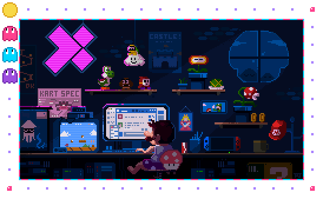

  

  
  
  

  
  
  

  

  

<h3 align="center">
  
  STATS &amp; AVATAR
</h3>

  
  &nbsp;&nbsp;&nbsp;&nbsp;
  

<h3 align="center">
  
  TROPHIES
</h3>

  

<h3 align="center">
  
  PROFILE SUMMARY
</h3>

  
   
  
  
   
  
  

  
<b>👾 Detailed Metrics（クリックで展開）</b>

   
  

    
  

  

